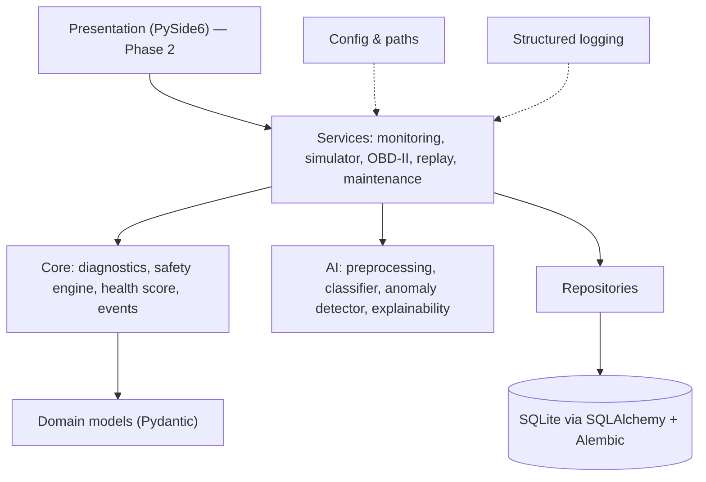

# SmartDrive Guardian AI

**Intelligent Vehicle Diagnostics & Predictive Maintenance**

SmartDrive Guardian AI is a Windows-first desktop application for vehicle telemetry monitoring,
hybrid rule-based and machine-learning diagnostics, anomaly detection and maintenance management.
It works fully offline, works without vehicle hardware through a built-in simulator, and can
optionally read live data from compatible ELM327 OBD-II adapters in a strictly read-only mode.

> **Project status: version 2.0.0 is in development. Phase 1 (Foundation & Architecture) is
> finished in code.** The desktop interface, simulator, AI engine and OBD-II integration are not
> built yet. See [ROADMAP.md](ROADMAP.md) for verified progress. Screenshots, model evaluation
> results and downloads will be added only once they exist.

## Safety disclaimer

SmartDrive Guardian AI is an experimental diagnostic and maintenance assistant. It is not a
certified vehicle safety system, autonomous driving system or replacement for a qualified
mechanic. If no abnormality is detected, that does not prove a vehicle is safe to drive.

## What works today (Phase 1)

- **Per-user data storage.** Data goes in the operating-system data folders (`%LOCALAPPDATA%` on
  Windows), never in the install or source folder. A portable mode is available with `--home`.
- **Validated preferences.** Theme, units, monitoring, alerts, OBD-II, retention, privacy and
  logging settings are type-checked and saved atomically. A corrupt preferences file is set
  aside and safe defaults are used.
- **Database foundation.** A SQLite schema covering vehicles, driving sessions, telemetry,
  diagnostic results, trouble codes, alerts, maintenance schedules and records, settings, model
  metadata and export history. It has foreign keys, check constraints and indexes, and Alembic
  migrations run automatically at startup.
- **Backup and restore.** Backups are consistent online copies that are checked after they are
  written. Before a restore, the current database is saved as a safety backup. Files that are not
  SmartDrive databases, or that come from a newer version, are refused.
- **Data separation.** Every driving session has exactly one data source (simulation, live or
  replay), so the different kinds of telemetry can't be mixed. Missing sensors are stored as
  "missing", never as zero.
- **Privacy-conscious logging.** Logs are rotating JSON lines, and VINs and registration numbers
  are masked.
- **Quality gates.** 100 automated tests, Ruff linting and formatting, and strict Mypy type
  checking. GitHub Actions runs CI on Windows and Ubuntu.

## Planned features

Each phase is detailed in [docs/SPECIFICATION.md](docs/SPECIFICATION.md):

- A PySide6 interface with a dashboard, live monitoring, gauges and charts, and dark and light themes.
- A digital vehicle garage, a simulation laboratory, trip recording and replay, and a maintenance centre.
- Hybrid diagnostics: transparent rules, a Random Forest classifier, Isolation Forest anomaly
  detection, SHAP explanations, and an experimental health score.
- Read-only OBD-II telemetry and trouble-code reading through Python-OBD.
- PDF and CSV reports, desktop and voice notifications, and a Windows installer.

## Architecture



The interface never queries the database, trains models or talks to the adapter directly. See
[docs/architecture.md](docs/architecture.md) for the layers and the decision log.

## Technology stack

| Area | Phase 1 (in use) | Later phases |
|---|---|---|
| Language | Python 3.12 | — |
| Configuration | Pydantic 2, platformdirs | — |
| Persistence | SQLite, SQLAlchemy 2, Alembic | — |
| Quality | pytest, pytest-cov, Ruff, Mypy (strict), pip-audit, GitHub Actions | pytest-qt |
| UI | — | PySide6, PyQtGraph, QSS |
| ML | — | scikit-learn, NumPy, pandas, SHAP, joblib |
| Hardware | — | python-OBD, pySerial |
| Output | — | ReportLab, pyttsx3 |
| Distribution | — | PyInstaller, Inno Setup, GitHub Releases |

Dependencies are added in the phase that first uses them. Version ranges are in `pyproject.toml`,
and exact cross-platform pins are in `requirements*.txt`.

## Installation (developers, Windows PowerShell)

Prerequisites: [Python 3.12 (64-bit)](https://www.python.org/downloads/) with the `py` launcher, and Git.

```powershell
cd E:\SmartDrive-Guardian-AI
powershell -ExecutionPolicy Bypass -File .\scripts\setup-dev.ps1
.\.venv\Scripts\Activate.ps1
```

The setup script creates `.venv`, installs the pinned dependencies, installs the package in
editable mode and runs every quality gate. To do it by hand:

```powershell
py -3.12 -m venv .venv
.\.venv\Scripts\python.exe -m pip install --upgrade pip
.\.venv\Scripts\python.exe -m pip install -r requirements-dev.txt
.\.venv\Scripts\python.exe -m pip install --no-deps -e .
```

## Usage

```powershell
smartdrive                       # version, data locations, schema revision, disclaimer
smartdrive --version
smartdrive db check              # SQLite integrity check
smartdrive db backup             # timestamped backup in the backups folder (old ones rotated)
smartdrive db backup --output D:\Backups\smartdrive.db
smartdrive db restore D:\Backups\smartdrive.db
smartdrive settings show
smartdrive settings reset
smartdrive --home .\portable-data info   # portable mode: keep everything in one folder
```

`python -m smartdrive` and `python main.py` are equivalent. From Phase 2, running `smartdrive`
with no command launches the desktop application.

## Testing

```powershell
.\scripts\check.ps1                     # ruff, format check, mypy, pytest + coverage
python -m pytest -m "not integration"   # fast unit tests only
```

Tests use temporary folders and databases only. They never touch your real application data.

## Project structure

```text
src/smartdrive/
├── app.py, cli.py, __main__.py     bootstrap/shutdown and command-line entry
├── config/                         constants, per-user paths, validated settings
├── models/                         Pydantic domain models (vehicle, session, telemetry)
├── database/                       engine, ORM schema, UTC types, repositories, migrations/
└── utils/                          logging, validators, exception hierarchy
tests/{unit,integration}/           pytest suites
docs/                               specification, architecture, database, developer guide
scripts/                            PowerShell setup, checks, dependency locking
```

Later phases add packages under `src/smartdrive/` (`core/`, `ai/`, `services/`, `ui/`,
`reports/`) when they gain real code. Empty placeholder modules are not committed.

## Documentation

- [Master specification](docs/SPECIFICATION.md)
- [Roadmap and progress](ROADMAP.md)
- [Architecture and decision log](docs/architecture.md)
- [Database design](docs/database.md)
- [Developer guide](docs/developer-guide.md)
- [Contributing](CONTRIBUTING.md) · [Security policy](SECURITY.md) · [Changelog](CHANGELOG.md)

## Known limitations

- There is no graphical interface yet; Phase 1 ships the foundation and a maintenance CLI.
- No machine-learning models exist yet, so no metrics are claimed.
- No OBD-II hardware has been tested. Hardware support will be marked experimental until it is
  physically verified.

## Licence

MIT has been proposed (see [LICENSE](LICENSE)) and is awaiting the repository owner's approval.

## Developer

Developed by [Hiranya-Bandara](https://github.com/Hiranya-Bandara).
