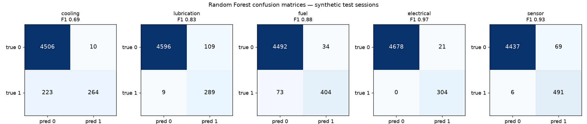
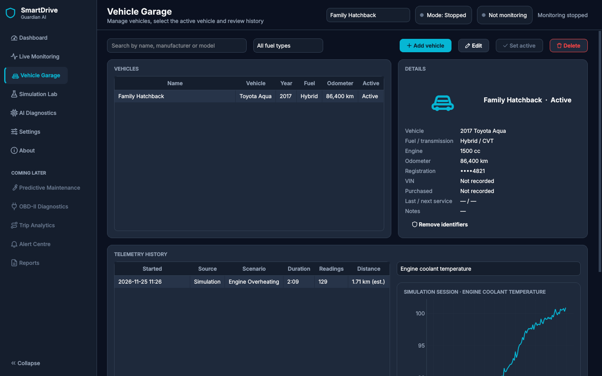
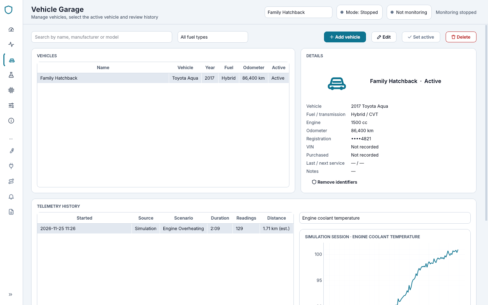
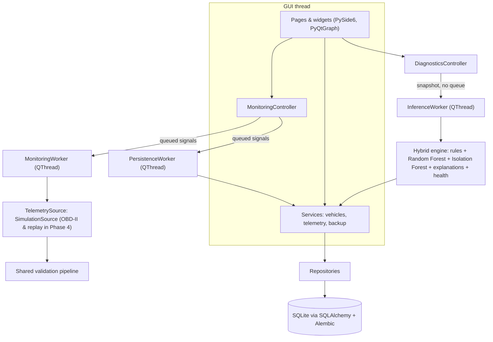

# SmartDrive Guardian AI

**Intelligent Vehicle Diagnostics & Predictive Maintenance**

SmartDrive Guardian AI is a Windows-first desktop application for vehicle telemetry monitoring,
hybrid rule-based and machine-learning diagnostics, anomaly detection and maintenance management.
It works fully offline, works without vehicle hardware through a built-in simulator, and can
optionally read live data from compatible ELM327 OBD-II adapters in a strictly read-only mode.

> **Project status: version 2.0.0 is in development. Phases 1 (Foundation), 2 (Desktop
> Application) and 3 (AI Engine) are implemented.** OBD-II, trips, maintenance and reports
> (Phase 4) are not built yet; their navigation entries are visible but disabled. See
> [ROADMAP.md](ROADMAP.md) for verified progress.
>
> **All machine-learning models were trained and evaluated on simulated data only.** The
> results below show how well they recover the simulator's own fault patterns. They are not
> evidence of real-world diagnostic accuracy.


## Safety disclaimer

SmartDrive Guardian AI is an experimental diagnostic and maintenance assistant. It is not a
certified vehicle safety system, autonomous driving system or replacement for a qualified
mechanic. If no abnormality is detected, that does not prove a vehicle is safe to drive.

## Features available today

### AI diagnostics (Phase 3)

- **Hybrid diagnostic engine.**
  - A transparent rule engine with configurable thresholds, persistence, hysteresis and
    missing/stale-data handling.
  - A multi-label **Random Forest** classifier covering cooling, lubrication, fuel, electrical and
    sensor faults.
  - An **Isolation Forest** anomaly detector trained on normal driving.
  - Rules are never overridden by a model. Model findings are at most *warning*, and an
    unexplained anomaly is *information* only.
- **Explainable AI.** Exact per-prediction feature contributions (tree-path decomposition)
  with supporting and opposing evidence, plus global permutation importance, shown as charts.
- **Experimental health score (0–100).** Every deduction is itemised, and the score is
  unavailable when data is insufficient. It is never presented as a safety rating.
- **AI Diagnostics page.**
  - Status, model availability, last inference time and inference latency, data completeness,
    findings with sources and evidence, model output per category, anomaly score and threshold.
  - Explanations, cautious recommendations, a live health trend, and a filterable, searchable
    diagnostic history.
  - Explicit states for: stopped, loading, insufficient data, stale, model unavailable,
    inference failure, no abnormality, warning and critical.
- **Background inference.**
  - Runs on its own thread every 2 s (configurable) and never overlaps or queues.
  - Results from a stopped run are discarded.
  - Telemetry keeps updating while inference runs, and shutdown is clean.
- **Persistence and alerts.** Assessments, findings, anomaly events and health history are
  stored per vehicle and session. Alerts are deduplicated with a cooldown.
- **Trusted models.** The bundled artefacts are verified by SHA-256 against the shipped
  manifest and checked against the scikit-learn minor version and the feature schema before
  loading. User-supplied model files are never loaded.
- **Reproducible pipeline.** One command regenerates the dataset, both models, the evaluation
  report and the figures (`scripts/train_models.py`).

### Desktop application (Phase 2)

- **Dashboard.** Active vehicle, monitoring controls, source and connection status, last-update
  time, coolant and RPM gauges, a digital speedometer, fuel, load and voltage indicators, live
  speed and coolant trends, and recent alerts.
- **Live monitoring.** Charts for 11 telemetry parameters with sensor selection, start, stop,
  pause and resume, configurable refresh interval (100 ms – 5 s) and time range, plus a
  minimum/maximum/average table. History is held in a bounded buffer.
  - Status is shown per sensor: OK, Missing, Not supported, Rejected (implausible),
    No response, Stale or Stopped.
  - Missing readings appear as gaps and "—", never as zero.
- **Vehicle garage.**
  - Add, edit and delete vehicles; deleting asks for confirmation.
  - Search and fuel filter, active-vehicle selection and optional vehicle images.
  - Validated forms with inline errors.
  - VIN and registration number are masked on screen and can be erased.
  - Per-vehicle history of recorded sessions, with a chart for any sensor.
- **Simulation laboratory.**
  - 15 reproducible, time-dependent scenarios: normal, idle, highway, urban, heavy traffic,
    rapid acceleration, overheating, cooling, lubrication, electrical and fuel-system
    abnormalities, sensor failure, missing sensors, intermittent connection loss, and multiple
    simultaneous faults.
  - Controls for seed, simulation speed (0.5–10×), noise level, ambient temperature and
    abnormality development time.
  - A manual driver mode, plus sliders that override individual sensor values.
  - Live ground-truth labels showing which faults are active and how severe they are.
- **Settings.** Dark, light or follow-system theme, metric or imperial units, monitoring
  intervals, data retention, log privacy and log level. Includes backup, restore and reset.
  Every change is saved immediately.
- **About.** Version, safety disclaimer, environment details, feature availability and licences.
- **Background workers.**
  - Telemetry polling and database writes run on their own threads.
  - Widgets are only updated through Qt signals.
  - Stopping or quitting shuts the workers down cleanly.
- **Interface.**
  - Collapsible sidebar, keyboard shortcuts and original line icons.
  - WCAG AA text contrast in both themes (checked by tests).
  - High-DPI support, and layouts that fit 1366×768 and up.

### Foundation (Phase 1)

- **Storage location.** Data lives in per-user OS folders, with a portable `--home` mode.
- **Preferences.** Validated preferences are saved atomically.
- **Database.** SQLite with Alembic migrations, verified backups, and validated restore with a
  safety copy taken first.
- **Logging.** Rotating JSON-lines logs with VIN and registration redaction.

## Model evaluation (synthetic data)

Source: [docs/ml/evaluation_report.md](docs/ml/evaluation_report.md), produced by
`python scripts/train_models.py`. The test split is 46 independent simulated sessions that were
never used for training or tuning.

| Measure | Result |
|---|---|
| Random Forest macro-F1 (5 categories) | **0.861** (micro-F1 0.864) |
| Rule-only baseline macro-F1 | 0.573 |
| "Any abnormality" false-positive rate on normal windows | 0.040 (0.035 with the app's 2-analysis confirmation) |
| Isolation Forest ROC AUC (normal vs fault windows) | 0.729 |
| Built-in healthy scenarios through the full engine | **0 alarms** in 40 ten-minute drives |
| Built-in fault scenarios through the full engine | detected in **35 of 35** drives (median delay 8–116 s after onset) |
| Median inference time (window → result incl. explanation) | about 50 ms on the build machine |

Known weaknesses are measured and documented. Cooling recall is 0.54 and appears to depend on
driving pattern (0.00 in the single heavy-traffic and single mixed-driving cooling session of the
test split, 0.78 idling, 0.82 highway; too few sessions for firm per-pattern rates).
Lubrication precision is 0.73. The anomaly detector flagged 6 of 22 healthy test sessions,
which is why an anomaly on its own never raises an alert.



## Screenshots

These are real renders of the application, made with `scripts/capture_screenshots.py`.


| | |
|---|---|
|  |  |
|  |  |
|  |  |
|  |  |

## Architecture



Pages never query the database or touch a worker thread directly. Details and the decision log
are in [docs/architecture.md](docs/architecture.md).

## Technology stack

| Area | In use | Later phases |
|---|---|---|
| Language | Python 3.12 | — |
| Desktop UI | PySide6-Essentials 6.12, PyQtGraph 0.14, QSS themes | — |
| Configuration | Pydantic 2, platformdirs | — |
| Persistence | SQLite, SQLAlchemy 2, Alembic | — |
| Quality | pytest, pytest-qt, pytest-cov, Ruff, Mypy (strict), pip-audit, GitHub Actions | — |
| ML | scikit-learn 1.9 (Random Forest, Isolation Forest), NumPy, SciPy, joblib; matplotlib for training reports only | — |
| Hardware | — | python-OBD, pySerial (Phase 4) |
| Output | — | ReportLab, pyttsx3 (Phase 4) |
| Distribution | — | PyInstaller, Inno Setup (Phase 5) |

## Installation (Windows PowerShell)

Prerequisites: [Python 3.12 (64-bit)](https://www.python.org/downloads/) with the `py` launcher, and Git.

```powershell
cd "E:\3rd Year\SmartDrive-Guardian-AI-Phase1\SmartDrive-Guardian-AI"   # your project folder
powershell -ExecutionPolicy Bypass -File .\scripts\setup-dev.ps1
.\.venv\Scripts\Activate.ps1
```

The setup script creates `.venv`, installs the pinned dependencies, installs the app in editable
mode and runs every quality gate.

## Usage

```powershell
smartdrive gui                    # launch the desktop application
smartdrive-gui                    # same, without a console window
python -m smartdrive gui          # same, without the installed entry point

smartdrive                        # CLI: version, data locations, schema revision
smartdrive db backup | db check | db restore <file>
smartdrive settings show | settings reset
smartdrive --home .\portable-data gui   # portable mode: keep everything in one folder
```

Keyboard shortcuts:

| Shortcut | Action |
|---|---|
| Ctrl+1 … Ctrl+7 | Open Dashboard, Live Monitoring, Garage, Simulation Lab, AI Diagnostics, Settings, About |
| Ctrl+M | Start or stop monitoring |
| Ctrl+P | Pause or resume |
| Ctrl+B | Collapse or expand the sidebar |
| Tab | Move between controls |

## Testing

```powershell
.\scripts\check.ps1                       # ruff, format check, mypy, pytest + coverage
python -m pytest -m "not ui"              # skip the GUI tests
python scripts\capture_screenshots.py     # regenerate docs/screenshots
python scripts\train_models.py           # regenerate dataset, models and evaluation (~20 min)
```

GUI tests run headless (`QT_QPA_PLATFORM=offscreen` is set automatically) and use temporary data
folders. They never touch your real data.

## Project structure

```text
src/smartdrive/
├── app.py, cli.py              bootstrap/shutdown, command line (info, gui, db, settings)
├── ai/                         dataset, features, training, classifier, anomaly detector,
│   │                           explanations, evaluation, reporting, trusted model registry
│   └── artifacts/              shipped models + manifest.json (SHA-256, versions, metrics)
├── config/                     constants, per-user paths, validated settings
├── core/                       sensors, units, validation, buffers, telemetry window,
│                               rule engine, health score, recommendations
├── models/                     Pydantic/dataclass domain models (vehicle, telemetry, diagnostics)
├── database/                   engine, ORM schema, repositories, migrations/ (0001, 0002)
├── services/                   simulator & scenarios, vehicles, telemetry, backup,
│                               hybrid diagnostic engine, diagnostic persistence & alerts
├── ui/
│   ├── application.py          Qt lifecycle and service wiring
│   ├── main_window.py, navigation.py, top_bar.py
│   ├── monitoring_controller.py, diagnostics_controller.py
│   ├── pages/                  dashboard, live monitoring, garage, simulation lab,
│   │                           AI diagnostics, settings, about
│   ├── widgets/                cards, gauges, charts, health score, findings, bar charts, …
│   ├── dialogs/                confirmation and vehicle dialogs
│   ├── workers/                monitoring, persistence and inference workers
│   └── themes/                 palettes, stylesheet template, theme manager
└── utils/                      logging, validators, exceptions
datasets/sdg-ds-1.1.0/          dataset metadata (the .npz itself is regenerated, not committed)
docs/ml/                        evaluation report, model and dataset cards, metrics, figures
scripts/                        setup, checks, dependency lock, screenshots, train_models.py
tests/{unit,integration,ui}/    pytest and pytest-qt suites
```

## Known limitations

- **Synthetic data only.** The models have never seen real vehicle data. Diagnostic
  categories are limited to what the 11 available signals can show; transmission and brake
  faults are not assessed.
- All telemetry currently comes from the simulator. Simulated faults are illustrative and not
  calibrated to any real vehicle.
- The model misses many developing cooling faults, especially in heavy-traffic and mixed
  driving (see the evaluation report). The rules still apply, but a clean result is never proof
  of safety.
- No OBD-II hardware support or testing yet (Phase 4).
- The GUI has been tested headless on Linux. It has not been run on Windows by the developer.
  The pinned Windows wheels are standard PySide6 builds.

## Documentation

- [Master specification](docs/SPECIFICATION.md) · [Roadmap](ROADMAP.md) · [Changelog](CHANGELOG.md)
- [User guide](docs/user-guide.md) · [Architecture](docs/architecture.md) · [Database](docs/database.md) · [Developer guide](docs/developer-guide.md)
- [Machine learning](docs/ml/README.md) · [Evaluation report](docs/ml/evaluation_report.md) · [Model card](docs/ml/model_card.md) · [Dataset card](docs/ml/dataset_card.md)
- [Contributing](CONTRIBUTING.md) · [Security policy](SECURITY.md)

## Licence

MIT has been proposed (see [LICENSE](LICENSE)) and is awaiting the repository owner's approval.

## Developer

Developed by [Hiranya-Bandara](https://github.com/Hiranya-Bandara).
