<p align="center">
  
  
</p>

<h1 align="center">SmartDrive Guardian AI</h1>

<p align="center"><strong>Intelligent Diagnostics. Smarter Maintenance.</strong></p>

<p align="center">
  <a href="https://github.com/Hiranya-Bandara/SmartDrive-Guardian-AI/actions/workflows/ci.yml"></a>
  
  
  <a href="LICENSE"></a>
</p>

SmartDrive Guardian AI is an offline-first Windows desktop application for **educational**
vehicle diagnostics and maintenance. It monitors engine telemetry in real time, analyses it with
a hybrid engine of transparent rules and machine-learning models that explain their predictions,
records and replays trips, keeps maintenance records and produces PDF and CSV reports. It works
without any hardware through a built-in simulator, and can read live data from ELM327-compatible
OBD-II adapters in a strictly read-only mode.

> **Status — version 2.0.0 release candidate (not yet published).** All features are
> implemented and tested in the development environment. The Windows executable and installer
> are fully configured but have **not yet been built and verified on Windows**; see the
> [release checklist](docs/release-checklist.md).
>
> **Hardware:** tested only with a software mock adapter — physical adapters and vehicles are
> **unverified**. **AI:** all models were trained and evaluated on **simulated data only**; the
> results below are not evidence of real-world accuracy. This is not a certified diagnostic or
> safety system. **Do not use it while driving.**

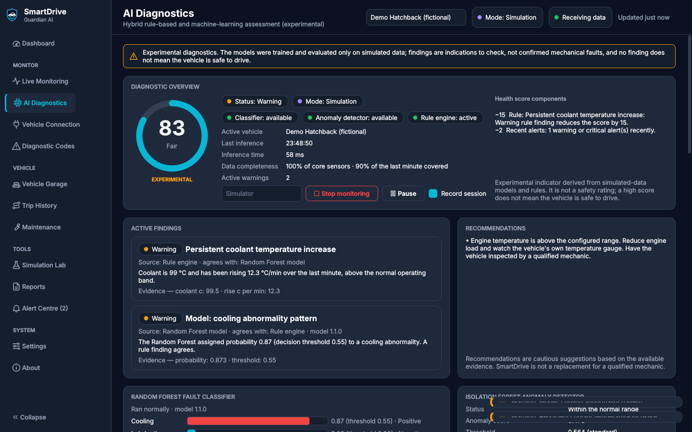

## Key features

| Area | What it does |
|---|---|
| **Monitoring** | Dashboard gauges and live charts for 11 signals, simulation, live (read-only OBD-II) and replay sources, each labelled on screen. |
| **Hybrid AI diagnostics** | 7 transparent rules + Random Forest fault classifier + Isolation Forest anomaly detector over 96 features; tree-path explanations; experimental health score; abstains on stale, incomplete or incompatible data. |
| **Simulation Lab** | 15 documented scenarios (overheating, electrical, fuel, lubrication, sensor failure, missing sensors, connection loss, …) with seed, speed, noise and fault development. |
| **Vehicle connection** | In-house ELM327 client: USB and Bluetooth COM ports, 19 standard parameters, supported-PID discovery, link quality, reconnection; never connects on its own. |
| **Trouble codes** | Stored, pending and permanent codes, MIL and freeze frame, scan history, generic descriptions; **no clear-codes function**. |
| **Trips** | Recording, summaries, estimated distance, diagnostic timeline, replay at 0.5–4× with seek. |
| **Maintenance** | Records, your own schedules and reminders, odometer, costs per currency, AI-related observations. |
| **Reports** | 7 PDF report types and 8 CSV datasets; identifiers excluded by default; formula-injection-safe CSV. |
| **Notifications** | Alert Centre with de-duplication and acknowledgement, Windows desktop notifications, optional offline voice. |
| **Desktop** | 13 pages, dark/light/system themes, keyboard shortcuts, background workers, first-run guide. |

## Download and installation

**Packaged Windows release** (installer or portable ZIP): published on the
[Releases page](https://github.com/Hiranya-Bandara/SmartDrive-Guardian-AI/releases) once
version 2.0.0 has been approved and released. The files are not code-signed; verify their
SHA-256 checksums as described in the [installation guide](docs/installation.md).

**From source** (Windows PowerShell, CPython 3.12 x64):

```powershell
git clone https://github.com/Hiranya-Bandara/SmartDrive-Guardian-AI.git
cd SmartDrive-Guardian-AI
powershell -ExecutionPolicy Bypass -File .\scripts\setup-dev.ps1
.\.venv\Scripts\Activate.ps1
smartdrive gui
```

## System requirements

Windows 10 or 11, 64-bit; about 500 MB of disk space for the application; 4 GB RAM or more
recommended; no Python, internet connection or administrator rights needed for the packaged
version. Optional: an ELM327-compatible USB or Bluetooth (COM port) adapter. Details:
[docs/system-requirements.md](docs/system-requirements.md).

## Getting started

1. Start the application. The **welcome guide** explains the modes and limits; reopen it from
   About.
2. **Vehicle Garage → Add vehicle** (VIN and registration are optional).
3. **Simulation Lab** → pick a scenario → **Start**. Watch the Dashboard, Live Monitoring and
   AI Diagnostics pages. Tick **Record session** to save a trip.
4. Explore **Trip History** (replay), **Maintenance**, **Reports** and the **Alert Centre**.

Full walkthrough: [user guide](docs/user-guide.md) · problems: [troubleshooting](docs/troubleshooting.md).

### Simulation mode

The default. Needs no hardware; every value is synthetic and labelled "Simulated telemetry".
Scenarios develop faults over time so you can see how rules, models and alerts respond.

### Live vehicle mode (experimental, read-only)

Pair or plug in an ELM327-compatible adapter, open **Vehicle Connection**, choose the port and
click **Connect** — the application never connects by itself. Only 65 allowlisted read
requests can be sent (checked twice, in the client and on the raw serial bytes): no clearing of
codes, ECU writes, actuator control, flashing, security access or typed commands. Live machine
learning is off by default. **Not yet verified with physical hardware** —
[hardware guide](docs/hardware.md) · [verification checklist](docs/hardware-verification-checklist.md).

## AI diagnostic architecture

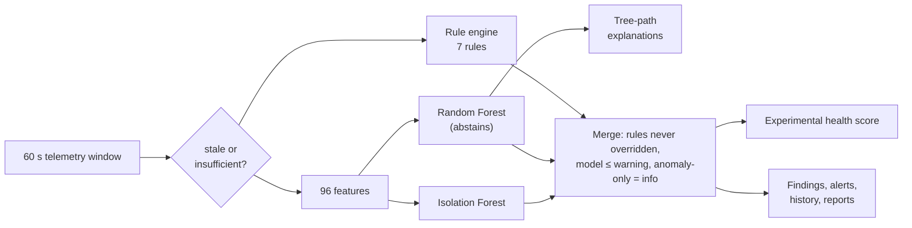

Rule findings, model predictions, anomaly flags, trouble codes and maintenance reminders are
always shown as separate kinds of evidence. Details: [docs/ml/README.md](docs/ml/README.md).

## Model evaluation results (synthetic data only)

Source: [docs/ml/evaluation_report.md](docs/ml/evaluation_report.md), produced by
`python scripts/train_models.py`. The test split is 46 independent simulated sessions that were
never used for training or tuning.

| Measure | Result |
|---|---|
| Random Forest macro-F1 (5 categories) | **0.861** (micro-F1 0.864) |
| Rule-only baseline macro-F1 | 0.573 |
| "Any abnormality" false-positive rate on normal windows | 0.040 (0.035 with the app's 2-analysis confirmation) |
| Isolation Forest ROC AUC (normal vs fault windows) | 0.729 |
| Built-in healthy scenarios through the full engine | **0 alarms** in 40 ten-minute drives |
| Built-in fault scenarios through the full engine | detected in **35 of 35** drives (median delay 8–116 s after onset) |
| Median inference time (window → result incl. explanation) | about 50 ms on the build machine |

Known weaknesses are measured and documented. Cooling recall is 0.54 and appears to depend on
driving pattern (0.00 in the single heavy-traffic and single mixed-driving cooling session of the
test split, 0.78 idling, 0.82 highway; too few sessions for firm per-pattern rates).
Lubrication precision is 0.73. The anomaly detector flagged 6 of 22 healthy test sessions,
which is why an anomaly on its own never raises an alert.


## Technology stack

| Area | Technology |
|---|---|
| Language | Python 3.12 |
| Desktop UI | PySide6-Essentials 6.12 (Qt 6), PyQtGraph 0.14, QSS themes |
| Data | SQLite, SQLAlchemy 2, Alembic, Pydantic 2, platformdirs |
| Machine learning | scikit-learn 1.9 (Random Forest, Isolation Forest), NumPy, SciPy, joblib; matplotlib for training reports only |
| Vehicle | pySerial 3.5 with an in-house read-only ELM327 client |
| Output | ReportLab (PDF), `csv`, pyttsx3 (offline speech, SAPI 5) |
| Quality | pytest, pytest-qt, pytest-cov, Ruff, Mypy (strict), pip-audit |
| Release | PyInstaller 6.22, Inno Setup 6, CycloneDX SBOM, GitHub Actions |

## System architecture

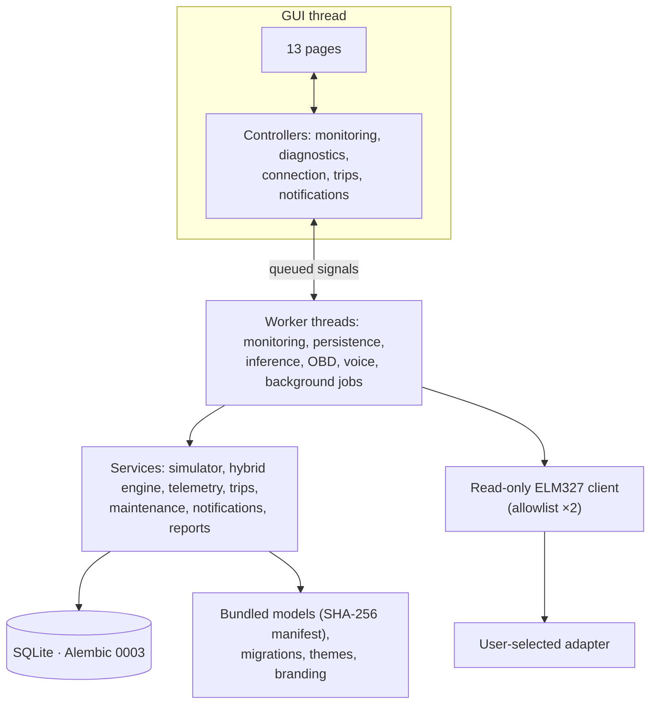

All nine diagrams (telemetry, AI, modules, database, threading, hardware, packaging, CI):
[docs/architecture-diagrams.md](docs/architecture-diagrams.md) · decisions:
[docs/architecture.md](docs/architecture.md).

## Database and storage

One SQLite database with 18 tables (vehicles, trips and telemetry, diagnostics and alerts, OBD
connections and trouble codes, maintenance, notifications, export history), migrated with
Alembic (revisions 0001–0003) and backed up automatically before every schema upgrade. Data
lives in `%LOCALAPPDATA%\SmartDriveGuardianAI`, never in the installation folder, and is kept
when the application is upgraded or uninstalled. [docs/database.md](docs/database.md)

## Security and privacy

No account, no internet requirement, no telemetry, analytics or advertising code. Identifiers
are optional, masked in logs and left out of reports by default. Only bundled, checksum-verified
models are loaded. Dependencies are pinned and audited; a CycloneDX SBOM accompanies each
release. [PRIVACY.md](PRIVACY.md) · [SECURITY.md](SECURITY.md) ·
[security review and threat model](docs/security-review.md)

## Automotive safety limitations

- Educational software; not a certified diagnostic, safety or autonomous-driving system, and no
  replacement for a qualified mechanic. "No finding" never means "safe to drive".
- A trouble code or finding is not a confirmed failed part; only generic code descriptions are
  provided.
- Physical OBD-II hardware is unverified; vehicle compatibility varies.
- Do not operate the application while driving.

More: [docs/known-limitations.md](docs/known-limitations.md).

## Screenshots

Real renders of the application (`scripts/capture_screenshots.py`) with a fictional vehicle and
simulated data. Vehicle Connection and Diagnostic Codes show the **mock adapter**, labelled as
such; no physical adapter was used.

| | |
|---|---|
| 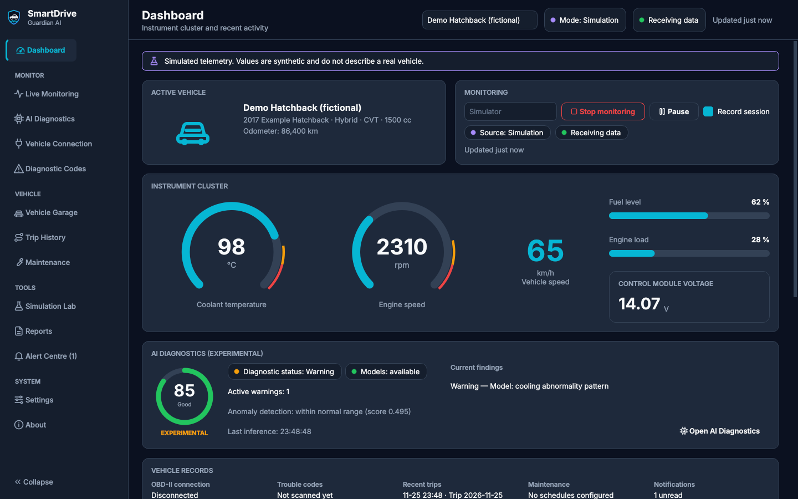 | 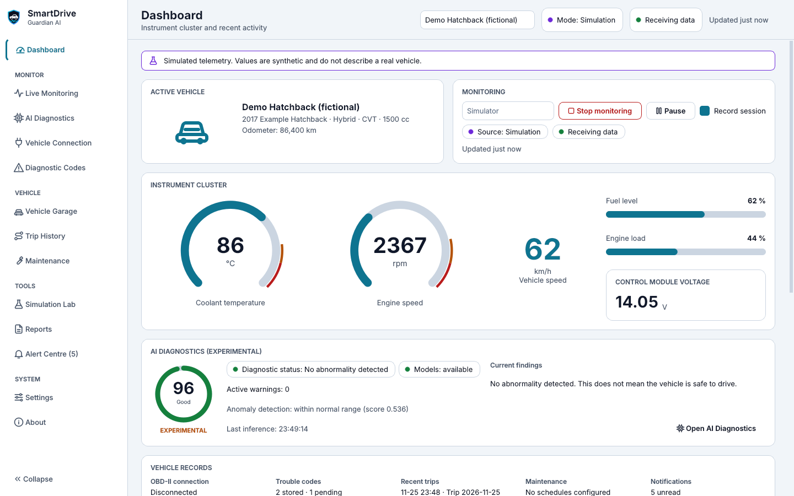 |
|  | 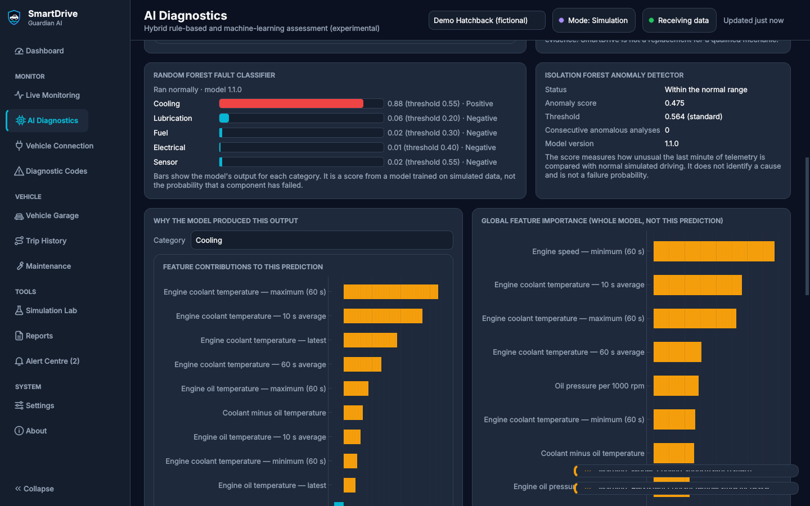 |
| 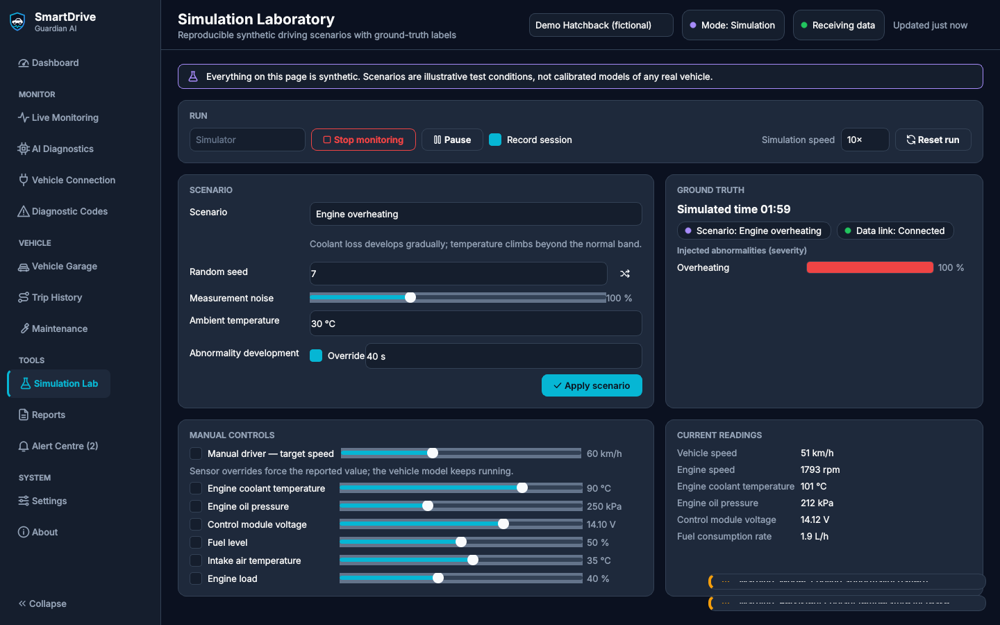 |  |
| 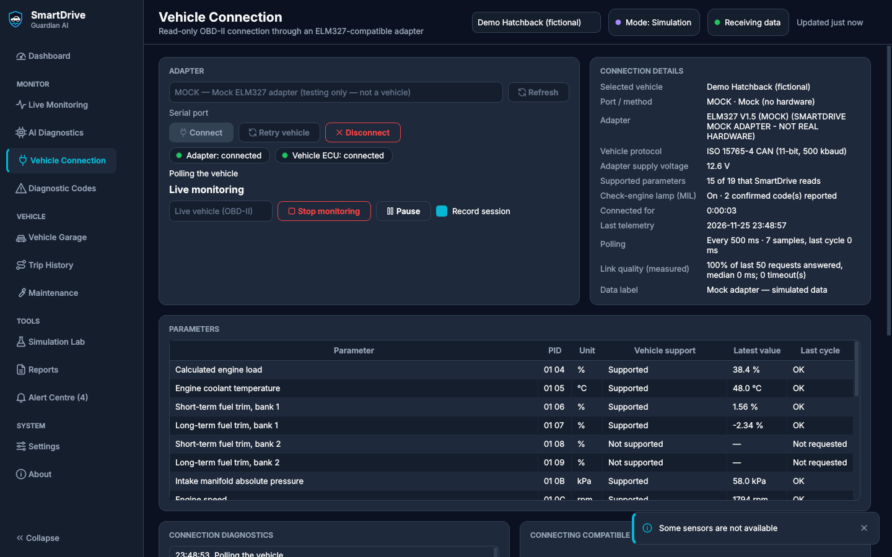 | 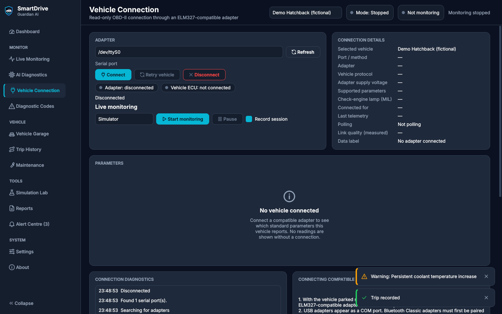 |
| 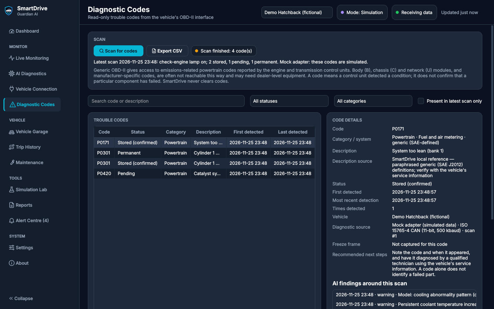 | 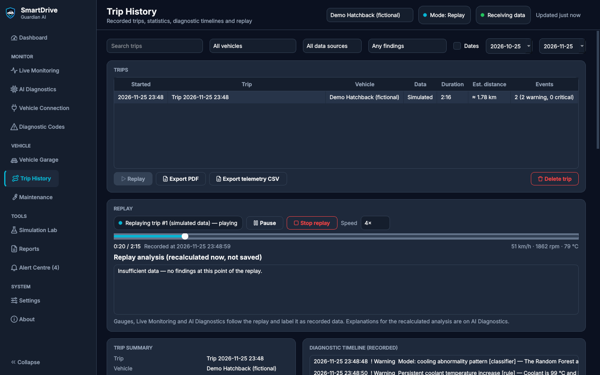 |
| 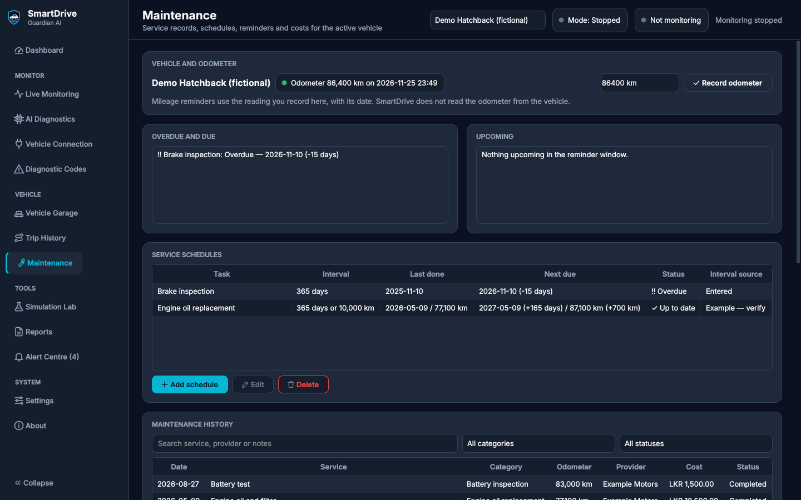 | 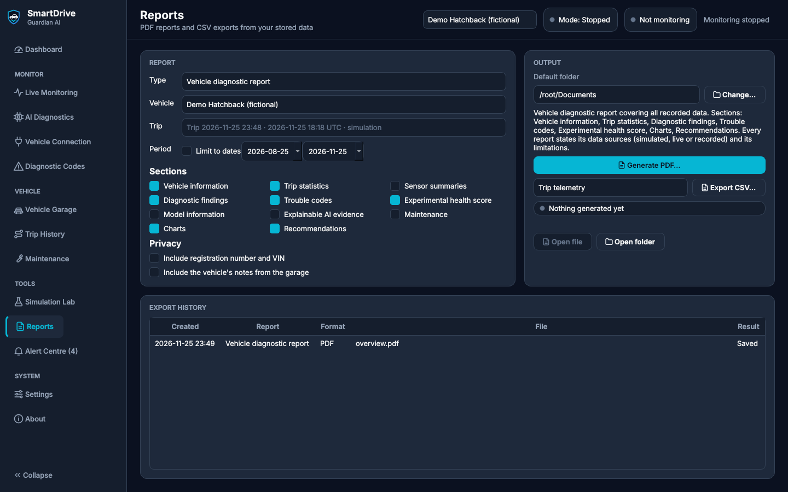 |
| 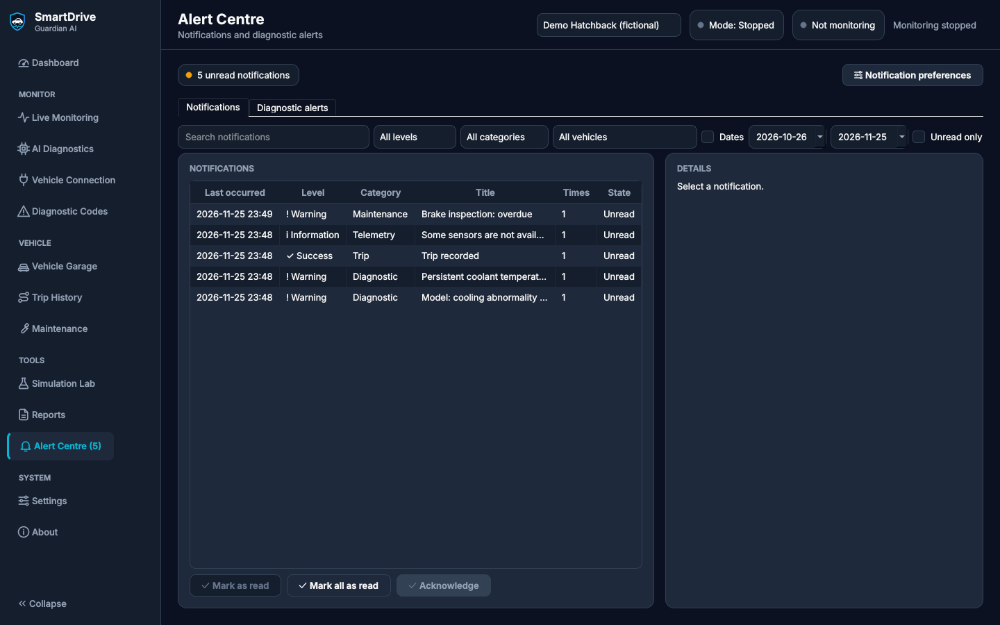 | 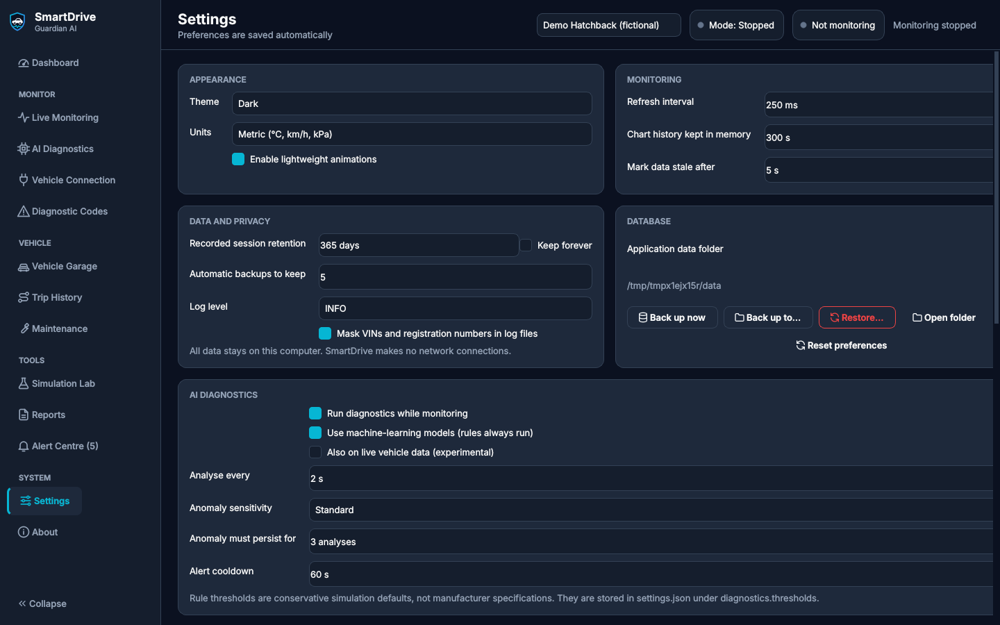 |
| 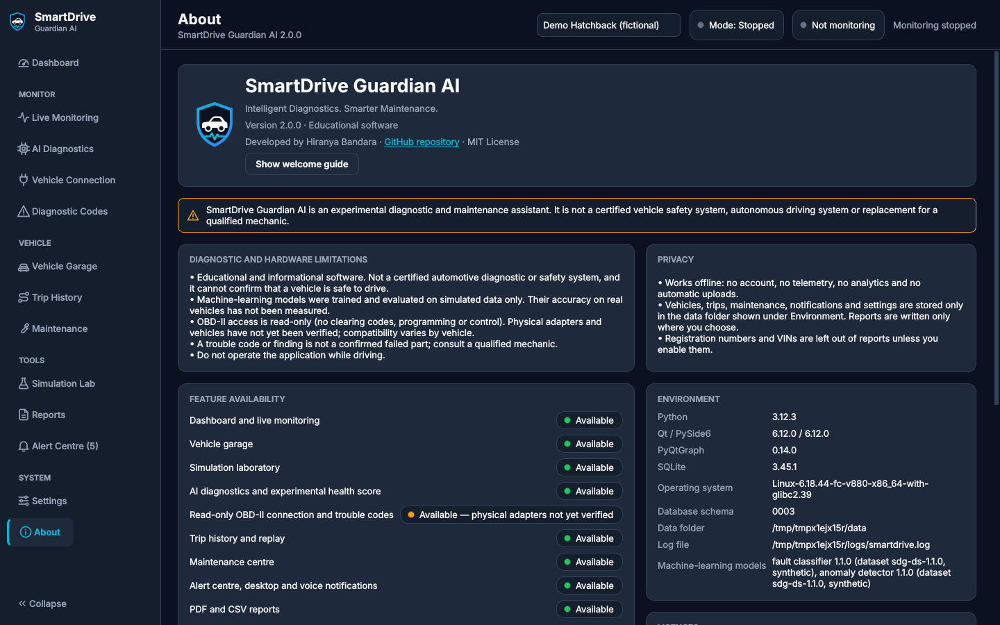 | 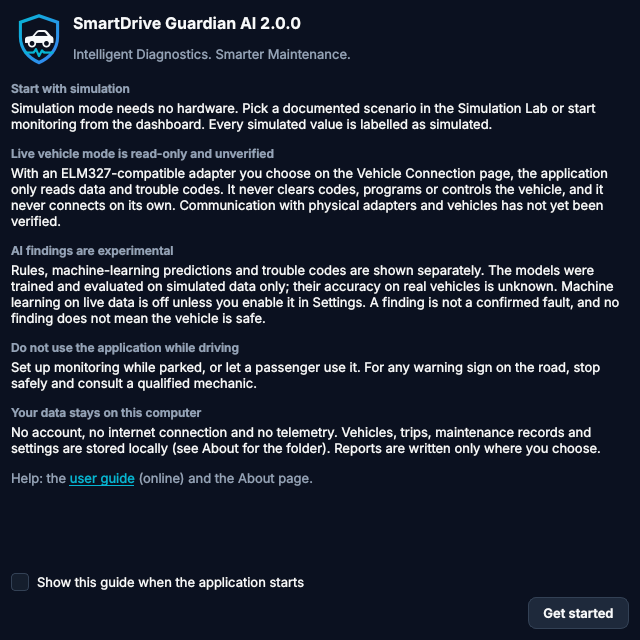 |

## Developer setup

```powershell
powershell -ExecutionPolicy Bypass -File .\scripts\setup-dev.ps1   # add -Release for build tools
.\.venv\Scripts\Activate.ps1
smartdrive gui                       # desktop application
smartdrive self-test                 # end-to-end installation check (simulated data)
smartdrive db backup | db check | db restore <file>
smartdrive --home .\portable-data gui   # keep all data in one folder
```

Keyboard shortcuts: Ctrl+1…7 (Dashboard, Live Monitoring, Garage, Simulation Lab, AI
Diagnostics, Settings, About), Ctrl+8/9/0 (Vehicle Connection, Diagnostic Codes, Alert Centre),
Ctrl+Shift+T/M/R (Trip History, Maintenance, Reports), Ctrl+M start/stop, Ctrl+P pause,
Ctrl+B sidebar. Guide: [docs/developer-guide.md](docs/developer-guide.md).

## Testing and verification

```powershell
.\scripts\check.ps1                 # Ruff, format check, Mypy (strict), pytest + coverage
python -m pytest tests\e2e          # end-to-end release scenarios A–H
```

Latest verified results (Linux development container, 25 November 2026): **643 tests, all
passing** (331 unit, 188 integration, 112 GUI, 12 end-to-end; 0 skipped), **91 % line and
branch coverage**, Ruff and strict Mypy clean, 0 known vulnerabilities in pinned dependencies.
These are not Windows results; Windows verification status is tracked in the
[release checklist](docs/release-checklist.md). GUI tests run headless and use temporary data
folders — they never touch your data. The hardware tests use a byte-level mock adapter.

## Build instructions

```powershell
python -m pip install -r requirements-release.txt
.\scripts\build-windows.ps1         # PyInstaller build, validation, smoke test, portable ZIP
.\scripts\build-installer.ps1       # Inno Setup installer
.\scripts\test-installer.ps1        # silent install, smoke test, upgrade, uninstall
.\scripts\generate-checksums.ps1    # SBOM, notices, build information, SHA256SUMS.txt
.\scripts\verify-release.ps1
```

The same steps run in GitHub Actions (`windows-build.yml`). Guide:
[docs/build-guide.md](docs/build-guide.md) · design: [docs/packaging.md](docs/packaging.md).

## Project structure

```text
src/smartdrive/
├── app.py, cli.py              bootstrap/shutdown, command line (info, gui, db, settings, self-test)
├── launcher.py, selftest.py    packaged entry point, installation self-test
├── resources.py                bundled read-only resources (dev and frozen)
├── branding/                   logo and icons (SVG masters, ICO, PNG)
├── ai/                         dataset, features, training, classifier, anomaly detector,
│   │                           explanations, evaluation, reporting, trusted model registry
│   └── artifacts/              shipped models + manifest.json (SHA-256, versions, metrics)
├── config/                     constants, per-user paths, validated settings
├── core/                       sensors, units, validation, buffers, telemetry window,
│                               rule engine, health score, recommendations
├── models/                     Pydantic/dataclass domain models (vehicle, telemetry, diagnostics)
├── database/                   engine, ORM schema, repositories, migrations/ (0001–0003)
├── obd/                        read-only ELM327 client, command allowlist, serial and mock
│                               transports, PID and DTC decoding, capabilities, sessions
├── reporting/                  report documents, PDF rendering, safe CSV writing
├── services/                   simulator & scenarios, replay, vehicles, telemetry, trips,
│                               maintenance, notifications & voice queue, DTC history and
│                               reference, reports, thresholds, backup, hybrid diagnostics
├── ui/
│   ├── application.py          Qt lifecycle and service wiring
│   ├── main_window.py, navigation.py, top_bar.py
│   ├── monitoring_controller.py, diagnostics_controller.py, vehicle_connection_controller.py,
│   │   trip_controller.py, notification_controller.py, gc_guard.py
│   ├── pages/                  dashboard, live monitoring, AI diagnostics, vehicle connection,
│   │                           diagnostic codes, garage, trip history, maintenance,
│   │                           simulation lab, reports, alert centre, settings, about
│   ├── widgets/                cards, gauges, charts, tables, health score, findings, …
│   ├── dialogs/                confirmation, vehicle, maintenance and file dialogs
│   ├── workers/                monitoring, persistence, inference, OBD, voice, job runner
│   └── themes/                 palettes, stylesheet template, theme manager
└── utils/                      logging, validators, exceptions
datasets/sdg-ds-1.1.0/          dataset metadata (the .npz itself is regenerated, not committed)
docs/ml/                        evaluation report, model and dataset cards, metrics, figures
docs/samples/                   sample PDF and CSV reports (simulated data)
packaging/                      PyInstaller spec, Inno Setup script, installer artwork
scripts/                        setup, checks, dependency lock, screenshots, train_models.py,
                                sample reports, brand assets, benchmark, release metadata,
                                build-windows / build-installer / smoke-test / test-installer /
                                generate-checksums / verify-release (.ps1)
tests/{unit,integration,ui,e2e}/  pytest and pytest-qt suites
```

## Documentation

- **Users:** [Installation](docs/installation.md) · [User guide](docs/user-guide.md) · [Troubleshooting](docs/troubleshooting.md) · [System requirements](docs/system-requirements.md) · [Known limitations](docs/known-limitations.md) · [Privacy](PRIVACY.md)
- **Vehicle hardware:** [OBD-II guide](docs/hardware.md) · [Hardware verification checklist](docs/hardware-verification-checklist.md) · [Reports](docs/reports.md)
- **AI:** [Machine learning](docs/ml/README.md) · [Evaluation report](docs/ml/evaluation_report.md) · [Model card](docs/ml/model_card.md) · [Dataset card](docs/ml/dataset_card.md)
- **Engineering:** [Architecture](docs/architecture.md) · [Diagrams](docs/architecture-diagrams.md) · [Database](docs/database.md) · [Developer guide](docs/developer-guide.md) · [Specification](docs/SPECIFICATION.md) · [Performance](docs/performance.md)
- **Release:** [Build guide](docs/build-guide.md) · [Packaging](docs/packaging.md) · [Release checklist](docs/release-checklist.md) · [Release verification](docs/release-verification.md) · [Security review](docs/security-review.md) · [Licensing](docs/licensing.md) · [Code signing](docs/code-signing.md) · [Release notes](RELEASE_NOTES.md) · [Changelog](CHANGELOG.md)
- **Project:** [Roadmap](ROADMAP.md) · [Contributing](CONTRIBUTING.md) · [Security policy](SECURITY.md) · [Third-party notices](THIRD_PARTY_NOTICES.md) · [Portfolio summary](docs/portfolio.md) · [Demo storyboard](docs/demo/storyboard.md)

## Roadmap

Phases 1–4 (foundation, desktop application, AI engine, vehicle integration) are complete;
Phase 5 (professional release) is complete in the development environment with Windows builds,
installer verification and publication pending. Next: Windows verification, physical adapter
testing, then publication of 2.0.0 as a pre-release. [ROADMAP.md](ROADMAP.md)

## License

[MIT](LICENSE) © 2026 Hiranya Bandara. Third-party components keep their own licences
([THIRD_PARTY_NOTICES.md](THIRD_PARTY_NOTICES.md)).

## Author

**Hiranya Bandara** — [github.com/Hiranya-Bandara](https://github.com/Hiranya-Bandara).
Built with AI-assisted development; design decisions, verification status and limitations are
documented in this repository.
