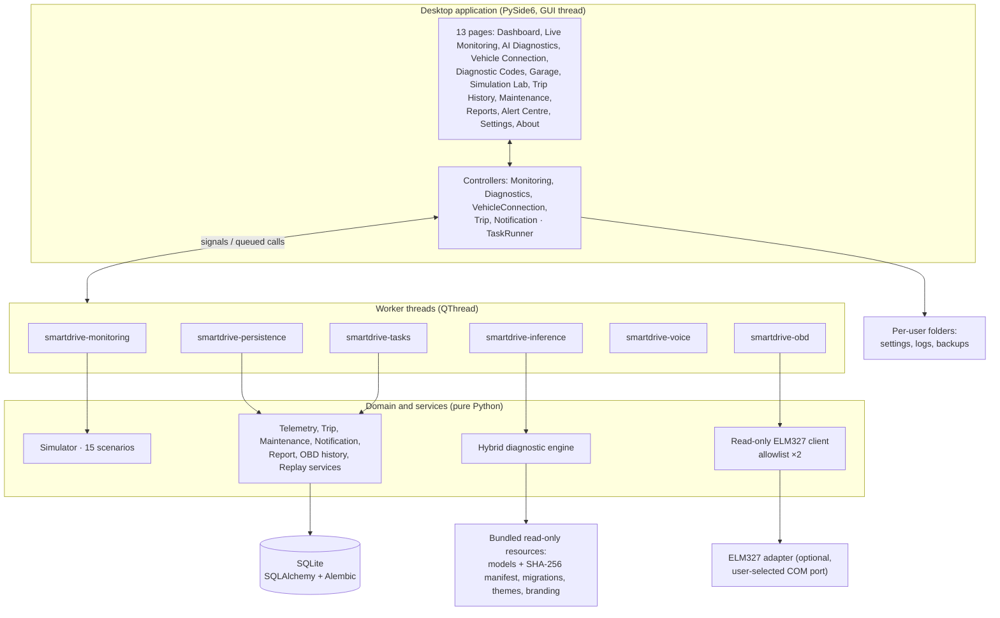
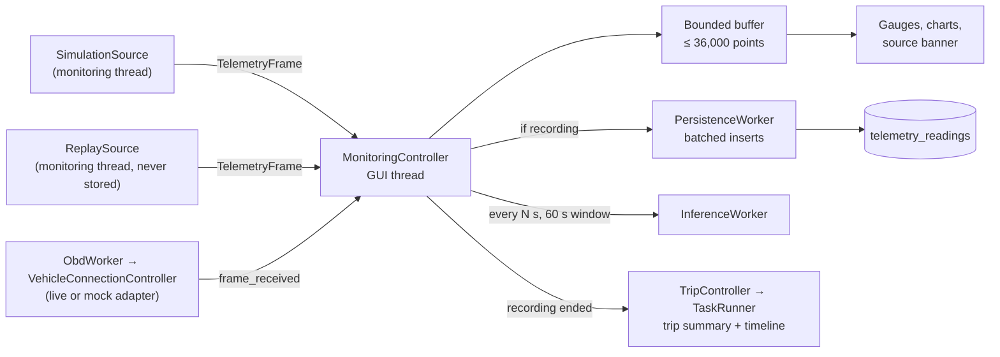
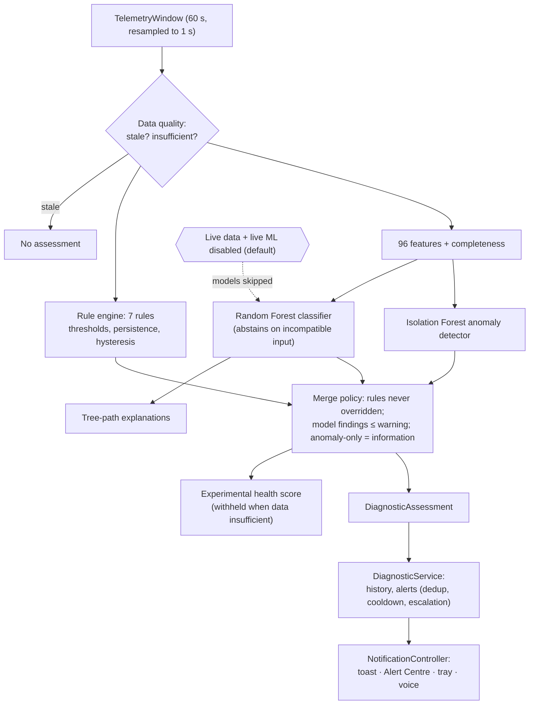
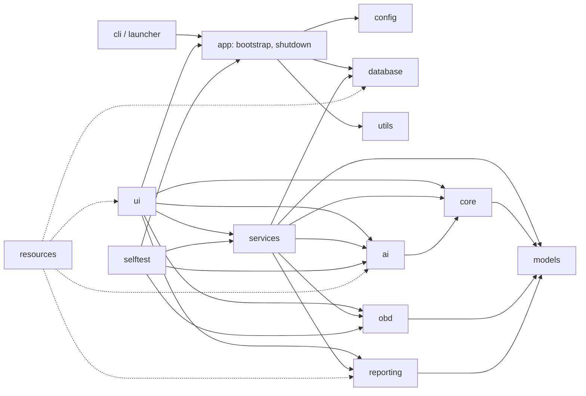
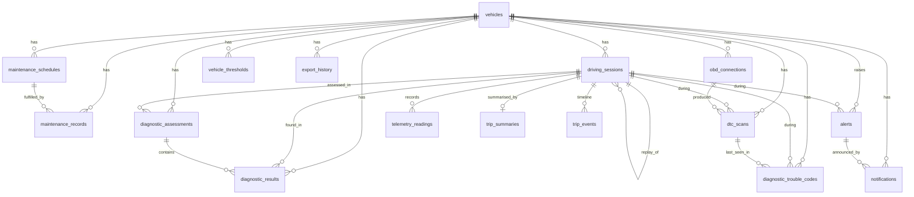
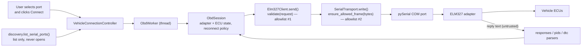
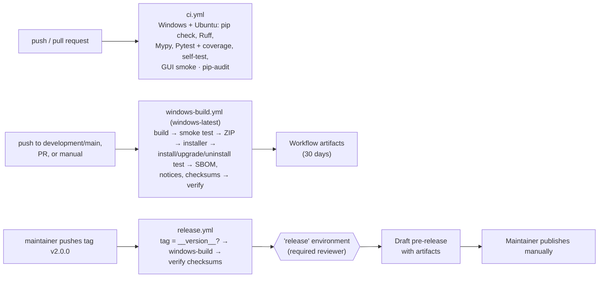

# Architecture diagrams

Diagrams of what is implemented in 2.0.0, drawn from the source code (module and class names
are real). Narrative and decisions: [architecture.md](architecture.md).

## 1. High-level system



## 2. Telemetry processing



Missing sensors stay `None` end to end; stale data stops assessment.

## 3. Hybrid AI diagnostics



## 4. Application modules



| Package | Responsibility |
|---|---|
| `config` | constants, per-user paths, validated settings |
| `database` | engine, ORM models, repositories, Alembic migrations, backup/restore |
| `models` | pydantic domain models (vehicle, telemetry, diagnostics, maintenance, notifications) |
| `core` | sensors and units, telemetry windows, rule engine, health score, recommendations |
| `ai` | dataset, features, classifier, anomaly detector, explanations, trusted model registry |
| `obd` | allowlist, ELM327 client, transports, discovery, PIDs, DTC parsing, mock adapter |
| `services` | simulator, scenarios, diagnostic engine/service, telemetry, trips, replay, maintenance, notifications, reports, voice |
| `reporting` | report documents, PDF (ReportLab), CSV with formula-injection protection |
| `ui` | application shell, pages, widgets, dialogs, controllers, workers, themes |
| `resources`, `launcher`, `selftest` | bundled resources, packaged entry point, installation self-test |

## 5. Database relationships



Plus `app_settings` and `model_metadata` (no relationships). Schema revisions: 0001 (Phase 1),
0002 (Phase 3), 0003 (Phase 4). Details: [database.md](database.md).

## 6. Workers and threading

```mermaid
sequenceDiagram
  participant GUI as GUI thread (controllers, pages)
  participant MON as smartdrive-monitoring
  participant PER as smartdrive-persistence
  participant INF as smartdrive-inference
  participant OBD as smartdrive-obd
  participant VOI as smartdrive-voice
  participant TSK as smartdrive-tasks
  GUI->>MON: start(simulation | replay)
  MON-->>GUI: frame_ready (queued signal)
  GUI->>PER: batch of samples (recording)
  GUI->>INF: window every N s (latest-only, stale results discarded)
  INF-->>GUI: assessment
  GUI->>OBD: connect / poll / scan (user action only)
  OBD-->>GUI: frames, scan results, link events
  GUI->>VOI: announcement (bounded, de-duplicated queue)
  GUI->>TSK: job (trip summary, replay load, export, retention; queue ≤ 16)
  Note over GUI: Python cyclic GC runs only here (gc_guard)
  GUI->>MON: shutdown order: monitoring → inference → OBD → voice → tasks
```

## 7. Hardware communication



Allowed: 14 adapter set-up commands, mode 01 (27 requests), mode 02 frame 0 (21), modes
03/07/0A. Everything else — including 04, 08, 09 and all UDS/KWP services — is rejected before
any byte is written.

## 8. Packaging

See [packaging.md](packaging.md#packaging-architecture) for the build flow diagram.

## 9. Continuous integration and release


