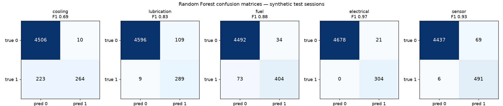
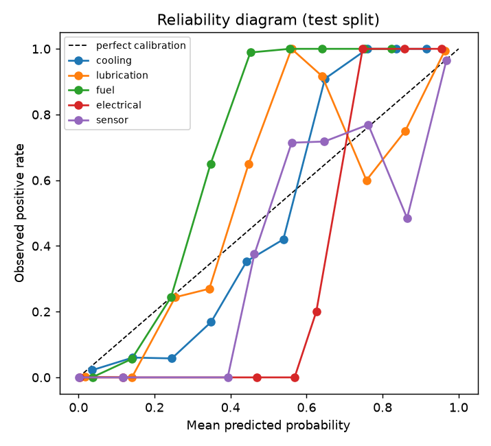
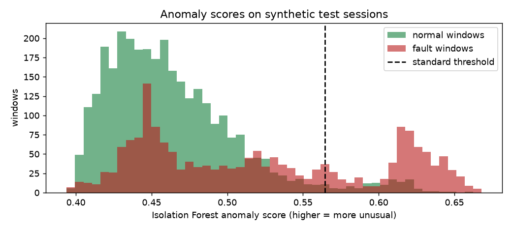

# Evaluation report

All results are from **synthetic data produced by the SmartDrive simulator**. They show how well the models recover the simulator's own fault signatures on unseen simulated sessions. They are **not** evidence of real-world diagnostic accuracy.

Test split: **46 independent simulated sessions** never used for training,
model selection or threshold tuning. Every number below was produced by
`python scripts/train_models.py`; rerunning it with the same configuration reproduces them.

## 1. Random Forest (all test windows)

Macro-F1 **0.861** · micro-F1 0.864 · subset accuracy
0.890 · Hamming loss 0.022

| Category | Precision | Recall | F1 | FPR | FNR | Support |
|---|---|---|---|---|---|---|
| cooling | 0.964 | 0.542 | 0.694 | 0.002 | 0.458 | 487 |
| lubrication | 0.726 | 0.970 | 0.830 | 0.023 | 0.030 | 298 |
| fuel | 0.922 | 0.847 | 0.883 | 0.007 | 0.153 | 477 |
| electrical | 0.935 | 1.000 | 0.967 | 0.004 | 0.000 | 304 |
| sensor | 0.877 | 0.988 | 0.929 | 0.015 | 0.012 | 497 |

"Any abnormality" detection: precision 0.927, recall
0.882, false-positive rate on normal windows
0.040.

Out-of-distribution abstention on the test split: 0.0% of windows.
Treating abstentions as "no finding" gives macro-F1
0.861.

### As used in the application

The application shows a model finding only after the same category is positive in
2 consecutive analyses. Applying that rule to the test sessions in
time order gives macro-F1 **0.857** and an "any
abnormality" false-positive rate of
0.035
(cooling FPR 0.001).

| Category | Precision | Recall | F1 | FPR | FNR | Support |
|---|---|---|---|---|---|---|
| cooling | 0.985 | 0.528 | 0.687 | 0.001 | 0.472 | 487 |
| lubrication | 0.745 | 0.953 | 0.837 | 0.021 | 0.047 | 298 |
| fuel | 0.942 | 0.813 | 0.873 | 0.005 | 0.187 | 477 |
| electrical | 0.938 | 0.990 | 0.963 | 0.004 | 0.010 | 304 |
| sensor | 0.881 | 0.972 | 0.924 | 0.014 | 0.028 | 497 |

## 2. Comparison with the rule-based baseline

The rule engine was run on the same windows in time order (with its persistence and hysteresis).
A rule "detects" a category when it reports a warning or critical finding for it.

| Category | Rules F1 | Random Forest F1 | Union F1 | Rules FPR | RF FPR |
|---|---|---|---|---|---|
| cooling | 0.529 | 0.694 | 0.694 | 0.000 | 0.002 |
| lubrication | 0.655 | 0.830 | 0.830 | 0.000 | 0.023 |
| fuel | 0.000 | 0.883 | 0.883 | 0.000 | 0.007 |
| electrical | 0.752 | 0.967 | 0.967 | 0.000 | 0.004 |
| sensor | 0.929 | 0.929 | 0.929 | 0.017 | 0.015 |

Macro-F1 — rules 0.573, Random Forest 0.861, union of both
0.861. The rules use fixed, conservative limits and need persistence, so they
miss early and mild faults; the classifier sees combinations of features (for example, oil
pressure per 1000 rpm and fuel use per unit load). In the hybrid engine the rules are never
overridden; the model adds findings and evidence.

## 3. Robustness

| Subset | Rows | Macro-F1 | Micro-F1 |
|---|---|---|---|
| missing_telemetry (completeness < 0.97) | 615 | 0.908 | 0.893 |
| complete_telemetry | 4388 | 0.855 | 0.861 |
| noisy (noise scale >= 1.5) | 1915 | 0.810 | 0.827 |
| low_noise (noise scale < 1.0) | 1585 | 0.906 | 0.903 |

## 4. Calibration

| Category | Brier score | Expected calibration error |
|---|---|---|
| cooling | 0.0461 | 0.0491 |
| lubrication | 0.0123 | 0.0226 |
| fuel | 0.0317 | 0.0694 |
| electrical | 0.0018 | 0.0088 |
| sensor | 0.0115 | 0.0078 |

Probabilities are shown as produced by the model and are described as model output, not as
the likelihood of a mechanical fault.

## 5. Isolation Forest

ROC AUC (normal vs any fault window): **0.729**. At the
standard threshold: window-level false-positive rate
0.040, detection rate
0.321. Detection rate by category:
`{"cooling": 0.117, "lubrication": 0.2584, "fuel": 0.0922, "electrical": 0.1809, "sensor": 1.0}`.

Session level (anomaly reported only after 3 consecutive anomalous
windows): 6 of 22
healthy test sessions raised a persistent anomaly; 9
of 24 fault sessions were flagged after the fault became labelled.

## 6. Inference latency (measured)

Measured on the build machine over 359 runs of one complete inference
(window → features → classifier → anomaly → explanation of the top category):
median **48.5 ms**, 95th percentile 79.6 ms.

## 7. Built-in scenarios through the complete hybrid engine

The full engine (rules, classifier with confirmation, anomaly detector with persistence) was
run exactly as in the application — one analysis every 2 s over a 60 s window — on every
catalogue scenario: 5 drives of 10 minutes each, with seeds that
appear nowhere in the training data. For healthy scenarios every warning or critical finding is
a false alarm.

| Scenario | Healthy | Analyses with alarm | Drives with alarm | Detected | Median delay |
|---|---|---|---|---|---|
| normal driving | yes | 0.0% | 0 of 5 | — | — |
| engine idling | yes | 0.0% | 0 of 5 | — | — |
| highway driving | yes | 0.0% | 0 of 5 | — | — |
| urban driving | yes | 0.0% | 0 of 5 | — | — |
| heavy traffic | yes | 0.0% | 0 of 5 | — | — |
| rapid acceleration | yes | 0.0% | 0 of 5 | — | — |
| engine overheating | no | 79.8% | 5 of 5 | 5 of 5 | 92 s |
| cooling system abnormality | no | 76.8% | 5 of 5 | 5 of 5 | 116 s |
| lubrication abnormality | no | 88.1% | 5 of 5 | 5 of 5 | 48 s |
| electrical abnormality | no | 94.3% | 5 of 5 | 5 of 5 | 16 s |
| fuel system abnormality | no | 81.3% | 5 of 5 | 5 of 5 | 80 s |
| sensor failure | no | 95.5% | 5 of 5 | 5 of 5 | 8 s |
| missing sensor values | yes | 0.0% | 0 of 5 | — | — |
| intermittent connection loss | yes | 0.0% | 0 of 5 | — | — |
| multiple abnormalities | no | 89.7% | 5 of 5 | 5 of 5 | 34 s |

## 8. Development notes (disclosed for transparency)

- Thresholds are the highest-F1 value subject to validation precision ≥ 0.9; the standard anomaly
  threshold is the 98th percentile of validation normal scores. Both use validation data only.
- **Dataset 1.0.0 → 1.1.0.** The first shipped models (dataset sdg-ds-1.0.0: 48 healthy
  sessions with randomly chosen driving patterns, every drive starting part-warm, at most 10
  minutes long) reported a cooling abnormality in 44–60 % of analyses of the healthy built-in
  *engine idling* scenario (3 seeds, measured with the complete engine). The held-out test split
  did not reveal this because it contained too few healthy idling sessions. Dataset 1.1.0 uses 120
  healthy sessions spread evenly over all six driving patterns, drives of 5–15 minutes and starting
  engine temperatures from cold to fully warm. The catalogue check in section 7 was added so that
  this class of problem is measured on every training run. This decision was made after seeing
  the behaviour of the first models.
- **Anomaly findings reported as information.** The first evaluation of the 1.1.0 models
  showed that the healthy *rapid acceleration* scenario produced an anomaly warning in 5 of 5
  drives (1.3 % of analyses), and that 6 of 22 healthy test sessions produced a persistent
  anomaly. An anomaly cannot name a cause and on its own detects only about a third of fault
  windows, so anomaly-only findings are now always INFORMATION and never raise alerts. This
  changed the engine's decision policy after test results had been seen. The models
  themselves were not retrained or re-tuned for it.
- The test split contains a few dozen sessions, so per-category estimates vary noticeably between
  splits.

## 9. Failure cases and limitations

- **Weakest category: cooling** (F1 0.694). Lowest recall: cooling (0.542); lowest precision: lubrication (0.726).
- Decision thresholds favour precision (validation precision ≥ 0.9), so the model accepts missed detections in exchange for fewer false alarms.
- **Detection depends on driving pattern.** Recall below 0.5 on the test split: cooling in heavy traffic driving (recall 0.00, 67 windows from 1 session(s)); cooling in mixed driving (recall 0.00, 84 windows from 1 session(s)). Each figure rests on very few sessions, so it is an indication rather than a measured rate: a fault that develops in these conditions may go undetected by the model (the rules still apply). See `recall_by_pattern` in metrics.json.
- The rule baseline almost never detects: fuel. Only the model covers these patterns.
- **Anomaly detector:** 6 of 22 healthy test sessions produced a persistent anomaly, and it detects only part of the fault windows. That is why an anomaly is reported as information and never raises an alert on its own.
- The robustness subsets differ in their mix of healthy and faulty sessions and of driving patterns, so their scores are not directly comparable with each other.
- Transmission and brake faults cannot be assessed: there is no telemetry for them.
- No real vehicle data was used. These figures must not be read as real-world accuracy.
