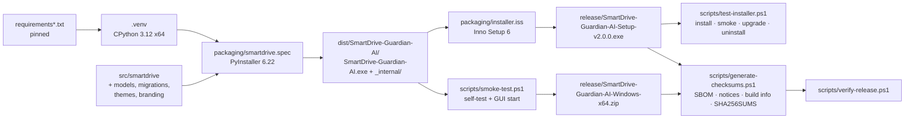

# Packaging architecture

How the Windows distribution is produced and what is in it. Build commands are in
[build-guide.md](build-guide.md); verification in [release-verification.md](release-verification.md).



## Distribution layout (one-folder)

```text
SmartDrive-Guardian-AI\
  SmartDrive-Guardian-AI.exe      windowed launcher (icon, version resource)
  LICENSE.txt, THIRD_PARTY_NOTICES.md, README.txt
  _internal\                      read-only runtime
    python312.dll, base_library.zip, PySide6\ (Qt DLLs and plugins), numpy\, scipy\, sklearn\ ...
    smartdrive\branding\          icons (SVG, ICO, PNG)
    smartdrive\ui\themes\         stylesheet
    smartdrive\ai\artifacts\      trusted models + manifest.json (SHA-256)
    smartdrive\database\migrations\  Alembic env.py, script.py.mako, versions\*.py
```

**Why one-folder.** PySide6, NumPy, SciPy, scikit-learn and the model artifacts amount to
several hundred megabytes. A one-file executable would unpack all of them to a temporary folder
on every start (slower start, more antivirus scanning, temporary files left behind on crashes),
and it would hide the Qt DLLs that the LGPL lets users replace. A one-file build is not provided.

**Writable data never goes into this folder** (it may be under `Program Files`). The application
writes only to the per-user folders in [PRIVACY.md](../PRIVACY.md), so it runs unchanged from
any installation path, including paths with spaces, and as a standard user.

## Resource loading

`smartdrive.resources.resource_path()` resolves bundled files through `importlib.resources`
relative to the `smartdrive` package. In a source checkout this is `src/smartdrive/...`; in the
frozen build PyInstaller places the same tree under `_internal/smartdrive/...`. No code builds
paths from the developer's machine or the current directory. `missing_resources()` lists anything
absent and is part of the self-test.

## Entry point

`packaging/launch.py` calls `smartdrive.launcher.main()`, which:

1. calls `multiprocessing.freeze_support()` (scikit-learn/joblib may start worker processes);
2. gives the windowed process (which has no console) null-device `stdout`/`stderr`;
3. opens the desktop application when no command is given, and otherwise runs the normal CLI
   (`self-test`, `info`, `db check`, `--home`, ...).

## What the spec includes and excludes

* All `smartdrive` modules except the training-time report module (which needs matplotlib).
* Hidden imports PyInstaller cannot see: scikit-learn classes used by the pickled models,
  `PySide6.QtOpenGL`/`QtOpenGLWidgets` (imported dynamically by pyqtgraph — found by the frozen
  GUI smoke test), Alembic `op`, the SQLite dialect, pyttsx3 drivers (SAPI5 and comtypes on
  Windows).
* Data files: themes, branding, model artifacts and manifest, evaluation metrics, migration
  scripts (kept as `.py` files because Alembic loads them from disk).
* Excluded: matplotlib, tkinter, test and build tools, optional imports of runtime packages that
  are not runtime dependencies (chardet, tomli, attrs, `pydantic.mypy`), and unused Qt modules.
  This keeps the bundle equal to the runtime set described by the SBOM.
* No UPX compression (UPX-packed binaries are flagged more often by antivirus heuristics).
* macOS-only packages (pyobjc) are never installed on Windows; `build-windows.ps1` fails if any
  appear.

## Version single source

`smartdrive.__version__` is the only place the version is written. `pyproject.toml` reads it
(`dynamic = ["version"]`), the spec builds the Windows version resource from it, the build
scripts pass it to Inno Setup (`/DAppVersion=`), and the About page, CLI (`--version`), PDF
metadata, SBOM and build information all read it. Tests fail if a version number is hard-coded
in the packaging files.

## Installer design

See the header of `packaging/installer.iss`: per-user installation by default
(`PrivilegesRequired=lowest`, installs to `%LOCALAPPDATA%\Programs\SmartDrive Guardian AI`),
optional all-users installation through the privileges dialog, Start Menu shortcut, optional
desktop shortcut, licence and safety pages, optional launch at the end, Restart Manager to close
a running copy, removal of the previous `_internal` folder on upgrade (application files only),
and an uninstaller that keeps user data and tells the user where it is.

## Verified so far

| Item | Linux (this development environment) | Windows |
|---|---|---|
| Spec builds | ✔ PyInstaller 6.22.3, Python 3.12.3 | Pending (GitHub Actions `windows-build.yml` or local) |
| Frozen self-test (13 checks) | ✔ from a path with spaces, without the virtual environment on `PATH` | Pending |
| Frozen GUI start and clean exit | ✔ (after the QtOpenGL fix) | Pending |
| Installer compiles / installs / upgrades / uninstalls | — (Inno Setup is Windows-only) | Pending |

A Linux build only shows that the spec, hidden imports and resource loading work; it says
nothing about Windows DLLs, the Windows Qt platform plugin, SAPI5 or the installer.
