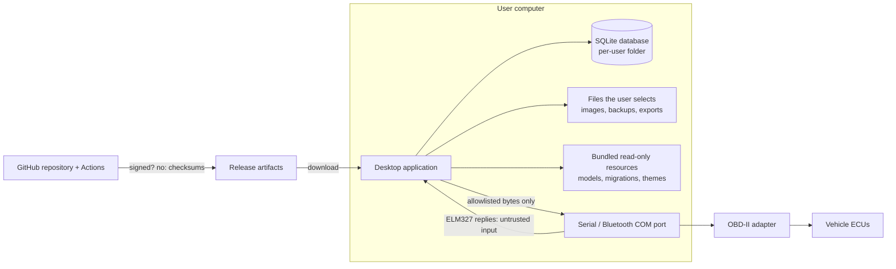

# Security, privacy and automotive safety review — version 2.0.0

Review date: 25 November 2026 · Scope: the complete source tree, dependencies, packaging,
installer and GitHub workflows of SmartDrive Guardian AI 2.0.0 · Method: manual code review
(with the reasoning recorded below), automated checks (Ruff's `S` security rules, strict Mypy,
pip-audit, the hardware-safety and release regression tests) and a threat model.

This is a self-review by the project, not an independent audit or penetration test. "No issue
found" means none was found by the methods listed, not that none exists.

## 1. Threat model

### Assets

| Asset | Why it matters |
|---|---|
| The user's vehicle | Wrong commands could change ECU state, clear evidence (trouble codes) or affect emissions systems. |
| Local database (vehicles, VIN/registration if entered, trips, maintenance, costs, diagnostics) | Personal and potentially location-revealing information about the user. |
| Settings, logs, backups, exported reports | Contain the same personal information in other forms. |
| Bundled model artifacts (joblib) | Pickle-based: loading a malicious file executes code. |
| Release artifacts (executable, installer, ZIP) | Users run them; a tampered file could compromise their computer. |
| Repository and CI pipeline | Source of every release. |

### Trust boundaries

1. **Application ↔ adapter/vehicle.** Everything the adapter returns is untrusted text; everything
   sent must be read-only.
2. **Application ↔ files the user selects.** Vehicle images, backups to restore, export
   destinations.
3. **Application ↔ bundled resources.** Trusted only as far as the installation folder is.
4. **Developer/CI ↔ user.** Release artifacts cross the internet.

### Attack surface and threats (STRIDE-style)

| # | Threat | Surface | Controls in place | Residual risk |
|---|---|---|---|---|
| T1 | A code path sends a write/clear/actuator/flash/security-access request to the vehicle | OBD client, transport | Closed allowlist of 65 exact requests (`obd/commands.py`); checked in `Elm327Client.send` **and again on the raw bytes at the transport boundary** (`ensure_allowed_frame`, added in 2.0.0) for both the serial and mock transports; one command per write, CR-terminated, canonical form only; no UI to type commands; no clear-codes function; tests attempt 32 prohibited requests and frame-injection variants (`tests/unit/test_hardware_safety.py`) and assert that only `obd/transport.py` opens serial ports and only `elm327.py` writes to a transport. | Adapter firmware bugs (an allowlisted request mishandled by a clone adapter) cannot be excluded without hardware testing. |
| T2 | The application connects to an arbitrary Bluetooth/serial device | Port discovery | Discovery only lists ports; a connection starts only when the user selects a port and clicks Connect; a remembered port is only preselected; startup never connects (`test_startup_never_touches_serial_ports`). | The user can still choose the wrong port; a non-OBD device receives only allowlisted ELM327 text. |
| T3 | Malformed adapter replies crash the app or are misinterpreted | Response parser | Typed parsing with bounds and error types; timeouts and cancellation; failures leave values missing, never zero; parse errors become connection errors, not crashes (Phase 4 tests). | Unknown real-adapter reply formats (unverified hardware). |
| T4 | Malicious model file executes code | `joblib.load` | Only the bundled artifact directory is used; SHA-256 must match `manifest.json` before loading; scikit-learn version and feature schema checked; no model import UI; the self-test reports integrity failures; failure falls back to rule-based diagnostics. | The manifest sits next to the artifacts: anyone who can write to the installation folder can replace both. Integrity checks detect corruption and accidental mismatch, **not** a deliberate attacker. Per-user installation means a process running as the user could do this; so could any malware with that access to the user's files anyway. Authenticode signing of the executable (not yet available) would not cover these data files either. |
| T5 | SQL injection | Repositories | SQLAlchemy ORM and bound parameters throughout; the only literal SQL is fixed `PRAGMA` statements. | None identified. |
| T6 | Path traversal / overwriting important files on export | Report and CSV export | User-chosen paths via the file dialog; folder must exist; allowed suffixes only; existing files are replaced only after the OS overwrite confirmation; atomic write through `mkstemp` in the target folder; permission errors reported. | A user can deliberately choose any folder they can write to. |
| T7 | CSV formula injection when exports are opened in Excel | CSV exporter | Cells starting with `= + - @` (and tab/CR) are prefixed with `'`; tests cover it. | Other spreadsheet tools may interpret content differently. |
| T8 | Malicious backup file on restore | `Database.restore` | SQLite header, `PRAGMA integrity_check`, known Alembic revision; safety backup of the current database first; migrated forward afterwards. | A crafted SQLite file could contain triggers or views; restore is meant for the user's own backups. |
| T9 | Oversized or disguised image on vehicle import | `VehicleService.import_image` | Suffix allowlist, 8 MiB limit, magic-number check, random file name inside the data folder. | Qt image decoders process the file (patched with Qt updates). |
| T10 | Personal data leaks through logs, reports, archives or telemetry | Logging, reports, packaging | No network code at all (no HTTP/socket modules imported); VIN/registration masked in logs by default; reports omit identifiers unless enabled; PDF metadata has title/author only; the source ZIP and installer exclude databases, logs and settings (`verify-release.ps1` checks the portable ZIP). | Users may share exported reports themselves. |
| T11 | Tampered release download | GitHub Releases | `SHA256SUMS.txt`, SBOM and build information published with the release; workflows build from tags only, upload to a draft; least-privilege tokens. | **Executable and installer are unsigned**: checksums published on the same page do not prove authorship against a compromised account. SmartScreen will warn. |
| T12 | Compromised CI dependency or action | GitHub Actions | Official actions pinned to full commit SHAs; `permissions: contents: read` by default, `contents: write` only in the draft-release job behind the `release` environment; `persist-credentials: false`; pinned Python dependencies; pip-audit in CI; Dependabot for pip and actions. | Python packages are pinned by version, not by hash. Inno Setup is installed from Chocolatey on the runner when missing. |
| T13 | Elevation of privilege through the installer | Inno Setup | `PrivilegesRequired=lowest` (per-user by default), no services, drivers, scheduled tasks, startup entries, file associations or environment changes; installs into `%LOCALAPPDATA%\Programs` unless the user chooses all users. | — |
| T14 | Denial of service through unbounded growth | Buffers, queues, history | Monitoring buffer capped (`MAX_BUFFER_POINTS`), bounded job queue (16), bounded voice queue (8), notification retention, telemetry retention (365 days default), backup rotation. Sustained-run measurements in `docs/performance.md`. | Very long recordings grow the database by design. |

## 2. Findings and changes in this release

| ID | Finding | Severity | Change |
|---|---|---|---|
| F1 | The allowlist was enforced only in `Elm327Client`; `SerialTransport.write` accepted any bytes. Not exploitable through the application today, but a future code path could have bypassed it. | Medium (defence in depth) | Added `ensure_allowed_frame` on the raw bytes in both transports; regression tests. |
| F2 | `CoInitialize` on the voice thread was never balanced by `CoUninitialize`. | Low (resource) | Balanced in `Pyttsx3Backend.close`, also when the engine fails to start; tested with a stand-in COM module. |
| F3 | The frozen GUI crashed at start-up: pyqtgraph imports `PySide6.QtOpenGL` dynamically. | High (availability of the packaged app) | Hidden imports added to the spec; found by running the frozen GUI smoke test. |
| F4 | Build-environment packages (chardet, tomli, attrs) were pulled into the bundle through optional imports, so the shipped set differed from the SBOM. | Low (supply-chain accuracy) | Excluded in the spec. |
| F5 | Licence text and README described MIT as pending approval while `LICENSE` is MIT. | Informational | Kept MIT (the existing decision); owner confirmation remains a release gate. |

No hard-coded credentials, `eval`/`exec`, `subprocess` or `shell=True`, unsafe YAML, unsafe
temporary files or network access were found in `src/`. `numpy.load` is used with
`allow_pickle=False` (training data only).

## 3. Dependency audit

`pip-audit 2.10.1`, PyPI advisory database, 25 November 2026. Raw results are in
`docs/security/pip-audit-*.json`.

| Lock file | Packages audited | Known vulnerabilities |
|---|---|---|
| `requirements.txt` (runtime, as resolved on Linux) | 26 | 0 |
| Windows-only runtime packages (comtypes 1.5.0, pywin32 312, pypiwin32 223), audited separately with `--no-deps` | 3 | 0 |
| `requirements-dev.txt` | 70 | 0 |
| `requirements-release.txt` | 63 | 0 |

A clean audit means no advisory was published for these exact versions at that time. It is not
evidence that the packages have no vulnerabilities. CI repeats the audit on every push.

## 4. Automotive safety

* Read-only by construction (T1) and by default user flow (no auto-connect, T2).
* Excluded: mode 04 (clear codes), mode 08 (control), mode 09 (VIN, for privacy), every
  UDS/KWP service (diagnostic sessions, security access, routines, writes, downloads/flashing,
  I/O control), CAN header/monitor/raw-frame adapter commands, user-typed commands.
* Simulation is the default mode; the application is fully usable without an adapter.
* Live and replay data are labelled on every page that shows them; mock-adapter data is
  labelled simulated.
* "Do not operate while driving" appears in the first-run guide, About page, live-data banner and
  installer.
* Physical adapter and vehicle behaviour is **unverified**
  (`docs/hardware-verification-checklist.md`).

## 5. AI safety

* Rule findings, model predictions, anomaly flags, trouble codes and maintenance reminders are
  separate types with separate labels.
* Models were trained on synthetic data; the UI, reports, About page and README say so.
* Machine learning on live data is off by default (`diagnostics.live_ml_enabled = false`) and
  needs explicit opt-in; even then the classifier abstains when inputs it was trained with are
  missing (most vehicles report no oil pressure).
* Missing sensors stay missing; the health score is withheld when data is insufficient.
* Model output never downgrades a rule finding (documented disagreement policy).

## 6. Privacy

See [PRIVACY.md](../PRIVACY.md). No telemetry, analytics, advertising SDKs, accounts or network
calls; the only outbound action is opening the GitHub page in the user's browser when they click
the link on the About page or in the welcome guide.

## 7. Recommended next steps

1. Obtain an Authenticode code-signing certificate before wide distribution
   ([docs/code-signing.md](code-signing.md)); sign the executable, uninstaller and installer.
2. Pin Python dependencies by hash for release builds (`uv pip compile --generate-hashes`).
3. Pin the Inno Setup version installed on CI runners.
4. Complete the physical hardware checklist with at least two adapter types before advertising
   live mode beyond "experimental".
5. Consider `PRAGMA trusted_schema=OFF` for restored databases.
